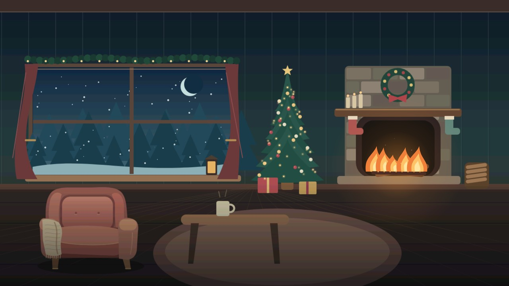

# Winter Cabin for Android TV

A silent, locally drawn winter room: snowfall outside the window, a flickering fireplace,
twinkling Christmas-tree lights, and an armchair with a draped throw.



**Animated CleanYourTV proposal, not an accepted gallery listing or a drop-in theme.**
The working Home + screensaver implementation needs custom launcher code. Copying a
`config.json` to stock CleanYourTV cannot enable this animation.

## Preview


This GIF alternates **two saved TV screenshots**, with no generated or interpolated frames.
It shows the final armchair artwork, not real-time playback or the animation's actual cadence.
The renderer schedules a frame every 83 ms (about 12 fps).

## What is here

- [`WinterCabinView.java`](app/src/main/java/com/gathin/winter/WinterCabinView.java): the
  same scene renderer used by the tested launcher, including the corrected armchair.
- [`CabinMotion.java`](app/src/main/java/com/gathin/winter/CabinMotion.java): deterministic
  motion model, with [five unit tests](app/src/test/java/io/github/tylerbuza/wintercabin/CabinMotionTest.java).
- A small, separately named [preview Activity](app/src/main/java/io/github/tylerbuza/wintercabin/CabinActivity.java)
  and [reference DreamService](app/src/main/java/io/github/tylerbuza/wintercabin/WinterCabinDream.java).
  They are **build-tested only, not TV-tested in this extracted application package**.
- [Integration notes and limitations](docs/integration.md).

This is intentionally not the personal launcher fork. It includes no viewing history,
resume-provider code, personal theme configuration, TV backup, install script or prebuilt APK.

## Tested status and limits

The scene was verified on **Hisense SmartTV 4K FFM, Android 11 / API 30, firmware 00.00.01.38**,
as both a Home background and an in-launcher screensaver. Actual-TV screenshots above were
captured on 13 November 2026. Snow, fire and lights were checked across captured frames.

The integrated version passed a reboot check before the drawing-only armchair revision.
The revised artwork was checked on Home and screensaver without another reboot. An earlier
separate-package screensaver prototype failed to cold-start after reboot on that firmware;
hosting the dream in the existing launcher worked. **The standalone reference here has not
been installed or retested on that TV.** No universal device compatibility is claimed.

Implementation bounds, **not measured CPU/GPU/battery benchmarks**:

- 64 snowflakes; one scheduled callback per 83 ms while eligible to animate.
- Cached 1280 x 720 RGB_565 static artwork: 1,843,200 bytes (about 1.76 MiB), excluding
  view, graphics and render-thread overhead. The moving effects are drawn on top.
- Callbacks stop when paused, detached or hidden. Explicit `stop()` also drops the bitmap
  reference; memory reclamation is managed by Android.
- No runtime libraries beyond Android; JUnit is test-only.
- No audio, decoder, video, blur, network request, analytics, boot receiver or key interception.

## Permissions

The [manifest](app/src/main/AndroidManifest.xml) requests **no permissions** (no
`<uses-permission>` entries).

`android.permission.BIND_DREAM_SERVICE` is a **service-side protection** restricting who can
bind the screensaver; it is not a permission the app requests. The preview Activity keeps
the display awake only while open. The dream is non-interactive and does not force bright mode.
The app does not register as Home, change the selected screensaver, or write system settings.

## Build and test locally

Requires JDK 17, Android SDK platform 34 and build-tools 34.0.0. Set `ANDROID_HOME` to your
local SDK, or create an untracked `local.properties` with its location. Gradle 8.9 and the
Android Gradle plugin 8.5.2 are pinned; initial builds download build tools and dependencies.

Linux/macOS:

```sh
./gradlew --no-daemon testDebugUnitTest lintDebug assembleDebug
```

Windows PowerShell:

```powershell
.\gradlew.bat --no-daemon testDebugUnitTest lintDebug assembleDebug
```

The debug APK is created locally under `app/build/outputs/apk/debug/`; it is not published.
Building does not connect to or modify a TV. Do not replace a working Home launcher to try
this reference. Any later sideload or screensaver selection is a separate, opt-in action.

Local validation: five unit tests passed, zero lint errors, and debug/release assembly passed.
The merged debug APK requests no permissions. This is build/source validation, not device
verification of the standalone hosts or a performance benchmark.

## CleanYourTV submission

Intended destination: the community behind [cleanyour.tv/addons](https://cleanyour.tv/addons).
The current feature-proposal route is
[Discussions / Ideas](https://github.com/Gathin23/cleanyourtv/discussions/categories/ideas).

The proposal asks the maintainer whether this should become an independent screensaver
add-on/module card, an optional launcher capability for animated Home scenes, or a separate
showcase project. This repository is **not yet a module-card add-on** and does not change
upstream launcher code, defaults, permissions, dependencies or size gates.

## License

MIT for this project's code and scene previews; see [LICENSE](LICENSE) and
[NOTICE.md](NOTICE.md). Gradle wrapper files retain their Apache 2.0 license.
